## 1. Introduction

This document describes how to verify and configure default file associations in Windows using the Windows Registry and an XML configuration file.

File associations determine which application Windows uses to open a particular file extension. They are managed through ProgIDs (Programmatic Identifiers), which link file extensions to application commands.

The procedure uses `.zip` files and 7-Zip as an example.

## 2. Check the File Association in the Registry

To identify the ProgID associated with a file extension, navigate to the following registry key:

```
HKEY_LOCAL_MACHINE\SOFTWARE\Classes\.zip
```

Check the `(Default)` value:

```
(Default)    REG_SZ    7-Zip.zip
```

This indicates that the `.zip` extension is associated with the ProgID `7-Zip.zip` in this registry location.

Important: Windows also maintains per-user file associations and a protected `UserChoice` setting. Therefore, this registry value alone does not necessarily represent the effective default application for the currently logged-in user.

## 3. Verify the ProgID and Associated Application

Once the ProgID has been identified, check which executable is configured to open the file.

Navigate to:

```
HKEY_LOCAL_MACHINE\SOFTWARE\Classes\7-Zip.zip\shell\open\command
```

Check the `(Default)` value. For example:

```
(Default)    REG_SZ    "C:\Program Files\7-Zip\7zFM.exe" "%1"
```

This command specifies:

- `7zFM.exe`: The executable used to open the file.
- `%1`: The file path passed as an argument to the application.

This confirms which executable is configured to handle files associated with the `7-Zip.zip` ProgID.

## 4. Check the Default File Association XML

Windows supports an XML configuration file to define default file associations.

Example location:

```
C:\file_associations.xml
```

The XML file should contain an entry for the `.zip` extension.

Example:

```
<?xml version="1.0" encoding="UTF-8"?>
<DefaultAssociations>
    <Association Identifier=".zip"
                 ProgId="7-Zip.zip"
                 ApplicationName="7-Zip" />
</DefaultAssociations>
```

## 5. Configure the XML File Through Group Policy

To deploy the XML configuration centrally, use Group Policy rather than manually editing the registry on every computer.

### Step 1: Configure the Group Policy

Open Group Policy Management Editor and navigate to:

```
Computer Configuration
  └ Administrative Templates
      └ Windows Components
          └ File Explorer
              └ Set a default associations configuration file
```

Configure the policy as follows:

1. Set the policy to Enabled.
2. Enter the XML file location:
   ```
   C:\file_associations.xml
   ```
3. Click Apply and OK.

The corresponding registry value is:

```
HKEY_LOCAL_MACHINE\SOFTWARE\Policies\Microsoft\Windows\System
```

Value:

```
Name: DefaultAssociationsConfiguration
Type: REG_SZ
Data: C:\file_associations.xml
```

Alternatively, configure it using PowerShell (run as Administrator):

```
New-Item -Path "HKLM:\SOFTWARE\Policies\Microsoft\Windows\System" -Force

Set-ItemProperty `
    -Path "HKLM:\SOFTWARE\Policies\Microsoft\Windows\System" `
    -Name "DefaultAssociationsConfiguration" `
    -Type String `
    -Value "C:\file_associations.xml"
```

Important: The XML file must exist on the target computer or at an accessible network location.

### Step 2: Apply the Group Policy

On the target computer, execute:

```
gpupdate /force
```

Sign out and sign back in to apply the default associations.

Important: This policy does not permanently prevent users from changing their file associations. Users can change them during their session, but the configured associations are reapplied at the next sign-in.

## 6. Export Existing File Associations

Instead of creating the XML file manually, you can export existing default associations from a reference computer.

Run the following command in an elevated Command Prompt:

```
Dism.exe /Online /Export-DefaultAppAssociations:C:\file_associations.xml
```

This generates an XML file containing the existing default file and protocol associations.

You can then edit the XML file to include the required applications and deploy it through Group Policy.

## 7. Verify the Configuration

Use the following commands to check the configuration on a target computer.

Check the configured XML file path:

```
reg query "HKLM\SOFTWARE\Policies\Microsoft\Windows\System" /v DefaultAssociationsConfiguration
```

Check the ProgID associated with `.zip`:

```
reg query "HKCU\Software\Microsoft\Windows\CurrentVersion\Explorer\FileExts\.zip\UserChoice"
```

Check the registered ProgID:

```
reg query "HKLM\SOFTWARE\Classes\7-Zip.zip\shell\open\command" /ve
```

The `UserChoice` registry key is particularly important because it indicates the user's selected association.

## 8. Summary

| Component                          | Purpose                                       |
| ---------------------------------- | --------------------------------------------- |
| `HKLM\SOFTWARE\Classes\.zip`       | Machine-level extension-to-ProgID association |
| `HKLM\SOFTWARE\Classes\7-Zip.zip`  | ProgID registration                           |
| `shell\open\command`               | Executable and command used to open files     |
| `HKCU\...\UserChoice`              | User's selected file association              |
| `file_associations.xml`            | Default associations configuration            |
| `DefaultAssociationsConfiguration` | Group Policy registry setting                 |

Key takeaway: To troubleshoot Windows file associations, check the extension's ProgID, verify the associated executable, and finally check the user's `UserChoice` registry entry. For centralized deployment, use the XML configuration file through Group Policy.

## Microsoft References

- [Microsoft – Configure default file associations using Group Policy](https://learn.microsoft.com/en-us/deployedge/edge-default-browser?form=MH17OH\&utm_source=chatgpt.com).
- [Microsoft – ApplicationDefaults Policy CSP](https://learn.microsoft.com/en-us/windows/client-management/mdm/policy-csp-applicationdefaults?source=recommendations\&utm_source=chatgpt.com).
- [Microsoft – Change default apps in Windows](https://support.microsoft.com/en-us/windows/apps/change-default-apps-in-windows?utm_source=chatgpt.com).

## Windows File Associations – Complete Technical Mind Map

```mermaid
flowchart TB
    ROOT(["🖥️ WINDOWS FILE ASSOCIATIONS<br/>How They Work & How to Configure Them"])

    ROOT --> S1
    ROOT --> S2
    ROOT --> S3
    ROOT --> S4
    ROOT --> S5
    ROOT --> S6

    subgraph S1["1. UNDERSTAND FILE ASSOCIATIONS"]
        direction TB
        A1["Association Resolution Chain"]
        EXT[".zip<br/>File Extension"]
        PID["7-Zip.zip<br/>ProgID"]
        EXE["7zFM.exe<br/>Application"]
        EXT -->|"Maps to"| PID
        PID -->|"Launches"| EXE
        A1 --> EXT
        NOTE1["ProgID = Programmatic Identifier<br/>Links file extension to application behavior"]
        EXE --> NOTE1
    end

    subgraph S2["2. CHECK MACHINE REGISTRY"]
        direction TB
        B1["Extension Registry Location"]
        B2["HKLM\SOFTWARE\Classes\.zip"]
        B3["Default Value<br/>REG_SZ = 7-Zip.zip"]
        B1 --> B2 --> B3
        B4["Machine-level association<br/>Can be overridden by per-user settings"]
        B3 --> B4
    end

    subgraph S3["3. IDENTIFY ASSOCIATED APPLICATION"]
        direction TB
        C1["ProgID Command Registry Location"]
        C2["HKLM\SOFTWARE\Classes\7-Zip.zip<br/>\shell\open\command"]
        C3["Executable Command"]
        C4["C:\Program Files\7-Zip\7zFM.exe %1"]
        C1 --> C2 --> C3 --> C4
        C5["7zFM.exe = Application executable<br/>%1 = File path passed as argument"]
        C4 --> C5
    end

    subgraph S4["4. CONFIGURE DEFAULT ASSOCIATIONS XML"]
        direction TB
        D1["XML Configuration File"]
        D2["C:\file_associations.xml"]
        D3["Association Entry"]
        D4["<Association Identifier='.zip'<br/>ProgId='7-Zip.zip'<br/>ApplicationName='7-Zip' />"]
        D1 --> D2 --> D3 --> D4
        D5["Windows Default Association Engine<br/>Uses XML to configure default handlers"]
        D4 --> D5
    end

    subgraph S5["5. DEPLOY THROUGH GROUP POLICY"]
        direction TB
        E1["Group Policy Navigation"]
        E2["Computer Configuration<br/>Administrative Templates<br/>Windows Components<br/>File Explorer"]
        E3["Set a default associations configuration file"]
        E1 --> E2 --> E3
        E4["Policy Registry Target"]
        E5["HKLM\SOFTWARE\Policies\Microsoft\Windows\System"]
        E6["DefaultAssociationsConfiguration<br/>= C:\file_associations.xml"]
        E3 --> E4 --> E5 --> E6
        E7["PowerShell Deployment"]
        E8["Set-ItemProperty<br/>-Path HKLM:\SOFTWARE\Policies\Microsoft\Windows\System<br/>-Name DefaultAssociationsConfiguration<br/>-Value C:\file_associations.xml"]
        E6 --> E7 --> E8
        E9["XML must be accessible locally or on network<br/>Associations are reapplied at user sign-in"]
        E8 --> E9
    end

    subgraph S6["6. VERIFY AND TROUBLESHOOT"]
        direction TB
        F1["Check Policy XML Path"]
        F2["reg query HKLM\SOFTWARE\Policies\Microsoft\Windows\System<br/>/v DefaultAssociationsConfiguration"]
        F3["Check UserChoice"]
        F4["reg query HKCU\Software\Microsoft\Windows\CurrentVersion\Explorer\FileExts\.zip\UserChoice"]
        F5["Check ProgID Command"]
        F6["reg query HKLM\SOFTWARE\Classes\7-Zip.zip\shell\open\command /ve"]
        F7["Test opening a .zip file"]
        F1 --> F2 --> F3 --> F4 --> F5 --> F6 --> F7
        F8["UserChoice reflects the user's selected association<br/>Windows protects this registry setting"]
        F4 --> F8
    end

    S1 --> S2
    S2 --> S3
    S3 --> S4
    S4 --> S5
    S5 --> S6

    FINAL(["KEY CONCEPT<br/>File Extension → ProgID → Application<br/>XML → Group Policy → Default Association Deployment"])

    S6 --> FINAL

    classDef root fill:#172554,color:#fff,stroke:#0f172a,stroke-width:3px
    classDef section fill:#dbeafe,color:#172554,stroke:#2563eb,stroke-width:2px
    classDef detail fill:#f1f5f9,color:#172554,stroke:#64748b
    classDef highlight fill:#cffafe,color:#164e63,stroke:#0891b2
    classDef final fill:#172554,color:#fff,stroke:#0891b2,stroke-width:3px

    class ROOT root
    class FINAL final
    class EXT,PID,EXE,E6,F7 highlight
    class A1,B1,B2,B3,B4,C1,C2,C3,C4,C5,D1,D2,D3,D4,D5,E1,E2,E3,E4,E5,E7,E8,E9,F1,F2,F3,F4,F5,F6,F8 detail
```


