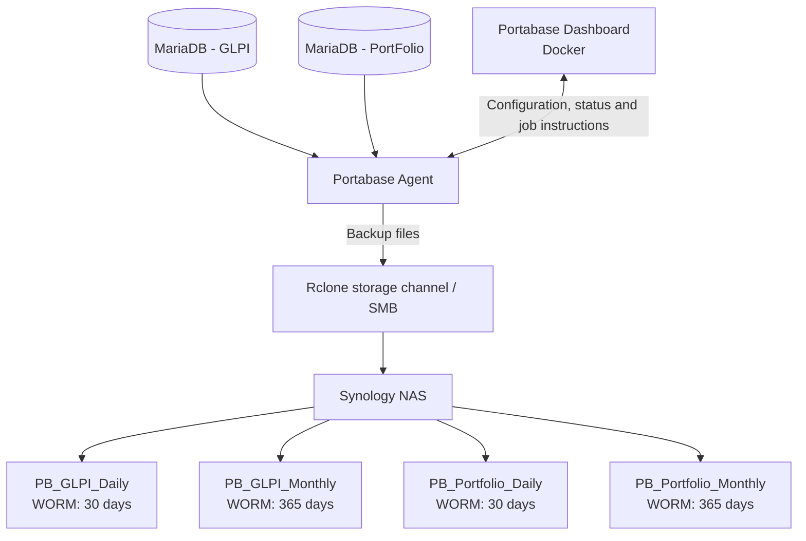
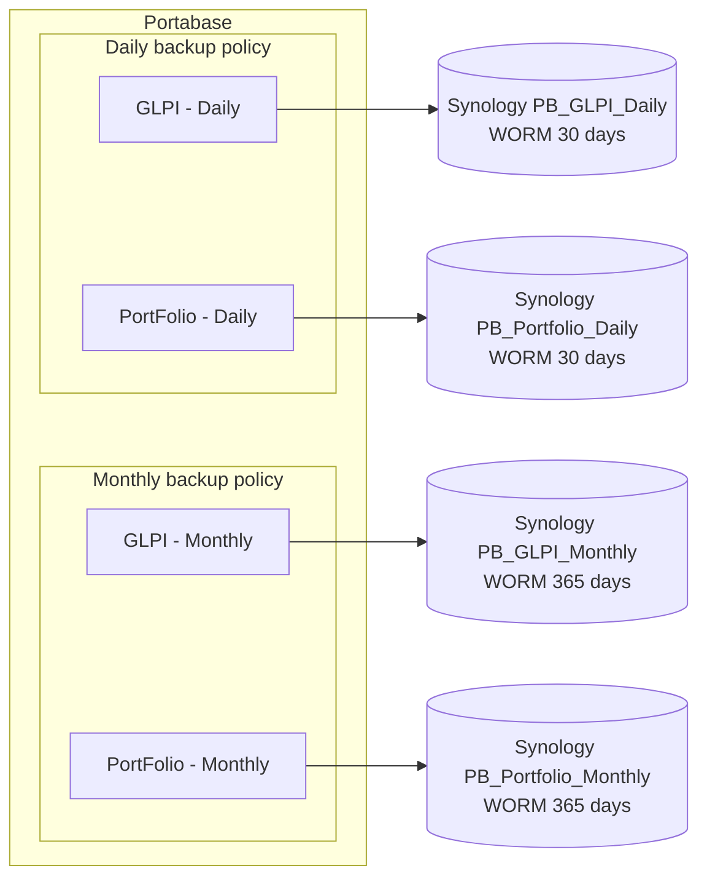

# Portabase + Synology WORM: MariaDB backup runbook

**Purpose:** Configure daily and monthly backups of the GLPI and PortFolio MariaDB databases, using Portabase for backup orchestration and a Synology NAS for WORM-protected storage.

**Last reviewed:** 2 November 2026  
**Environment assumed:** Portabase Dashboard in Docker; a Portabase Agent on the network where MariaDB is reachable; Synology DSM with SMB enabled and WriteOnce (WORM) shared-folder support.

> **Important:** Replace every example IP address, username, password, database name and share name with the values from your environment. Never paste a real password into a knowledgebase article.

---

## 1. Target workflow

The original workflow diagram supplied for this design is included below for reference.


The intended backup policy is:

- **GLPI:** daily backups retained for approximately 30 days, plus monthly backups retained for approximately 12 months.
- **PortFolio:** daily backups retained for approximately 30 days, plus monthly backups retained for approximately 12 months.
- **Storage:** separate Synology WORM shared folders for each database and retention class.

### 1.1 Logical architecture



Portabase has two main components: the Dashboard manages configuration and policies; the Agent connects to the databases, performs backups and sends backup files to configured destinations. The Agent must be able to reach both MariaDB and the NAS. The Dashboard does not connect directly to the databases.

### 1.2 Target backup streams

The exact four-stream design requires independent daily and monthly backup streams:



### 1.3 Important Portabase behaviour and design constraints

1. **Projects:** A project groups databases. Portabase release 1.28.0 added project-level policies and policy inheritance for cron schedules, retention and storage. Therefore, do not assume that projects are only labels when using a recent version. Check the installed Dashboard version and the policy inheritance/override indicators in the UI. A database has an optional project assignment; the public documentation does not establish that one database can belong to multiple projects.
2. **One retention policy per managed database entry:** Portabase documents one retention policy per database entry. The available strategy types include count, days and GFS. GFS can retain hourly, daily, weekly, monthly and yearly restore points within one policy.
3. **Multiple storage policies do not separate retention tiers:** Portabase sends each backup to every enabled storage destination attached to that database. It does not document a rule that sends only GFS monthly restore points to a monthly destination. Attaching both daily and monthly channels to one database would send every backup to both folders.
4. **Duplicate entries for one physical MariaDB database:** The four-stream design above assumes that Portabase accepts two independent managed database entries pointing to the same physical MariaDB database (one daily and one monthly). This must be tested with the installed version before production. Do not assume it is supported just because the UI permits adding a database.

**Practical decision:** First test whether Portabase allows two independent managed entries for the same physical MariaDB source, each with its own ID, schedule, retention and storage channel. If it does, use the four-stream layout. If it does not, use one Portabase entry with a daily schedule and GFS retention, or keep Portabase for daily backups and run the monthly MariaDB export as a separate, independently monitored job. The single-entry/GFS option does not provide different WORM lock periods for daily and monthly files in separate folders by itself.

---

## 2. Plan the four Synology shared folders

Create four dedicated shared folders in DSM:

| Purpose | Example shared-folder name | WORM retention target |
|---|---|---:|
| GLPI daily | `PB_GLPI_Daily` | 30 days |
| GLPI monthly | `PB_GLPI_Monthly` | 365 days |
| PortFolio daily | `PB_Portfolio_Daily` | 30 days |
| PortFolio monthly | `PB_Portfolio_Monthly` | 365 days |

Use names consistently. The SMB shared-folder name is case-sensitive in the Rclone remote path on some servers/configurations, so copy it exactly from DSM.

### 2.1 Create a dedicated SMB service account

In DSM, create a dedicated account, for example:

```text
Username: portabase-backup
```

Do not use the Synology administrator account for routine backups. Grant this service account only the access it needs to write to the four backup shares. Check the actual permissions required by the storage test and Portabase upload process. Avoid granting broad access to unrelated NAS folders.

Record the following values securely (not in this article):

| Setting | Example | Notes |
|---|---|---|
| NAS hostname/IP | `192.168.1.50` | Use the real stable NAS address |
| SMB port | `445` | Standard SMB port |
| SMB username | `portabase-backup` | Dedicated account |
| SMB password | `[stored securely]` | Do not put it in this document |
| SMB domain | `WORKGROUP` | Typical default for a local NAS account |
| Shared folders | Names in the table above | One share per retention destination |

---

## 3. Install Rclone on the Ubuntu host (not inside the Portabase Dashboard container)

Rclone is used to create and test an SMB remote configuration. Portabase's Rclone storage channel accepts one remote definition pasted into the Dashboard. You do **not** need to install Rclone manually inside the Portabase Dashboard container just to generate this configuration.

On the Ubuntu host:

```bash
sudo apt update
sudo apt install -y rclone
rclone version
```

**Network note:** Portabase's Agent performs the database backup and sends it to storage. Ensure the Agent's host/container network can reach the NAS on TCP port 445. Testing Rclone from the Ubuntu host is useful, but if the Agent runs in a separate Docker network or on another host, host-side success alone does not prove that the Agent can reach the NAS.

---

## 4. Create an Rclone SMB remote

Start the interactive configuration wizard:

```bash
rclone config
```

Follow the prompts:

1. Choose `n` for **New remote**.
2. Enter a remote name, for example `synology`.
3. Choose the storage type `smb` (SMB/CIFS).
4. Enter the Synology hostname or IP address, for example `192.168.1.50`.
5. Enter the SMB service-account username, for example `portabase-backup`.
6. Accept port `445`, unless your NAS uses a different SMB port.
7. When prompted for a password, choose to enter your own password and type the service-account password interactively.
8. For a local Synology account, accept the default `WORKGROUP` domain unless your configuration requires something else.
9. Leave advanced settings at their defaults initially, then save the remote.

Rclone calls the SMB backend `samba` in the saved configuration. A typical section looks like this:

```ini
[synology]
type = samba
host = 192.168.1.50
user = portabase-backup
port = 445
pass = <OBSCURED_PASSWORD_GENERATED_BY_RCLONE>
domain = WORKGROUP
```

This is an example only. Rclone may omit default fields such as `port` or `domain`; that is normal. The `pass` value must be generated by Rclone, not typed as plain text.

### 4.1 What does the obscured password mean?

Rclone automatically stores an obscured form of the password when you enter it through `rclone config`. This is **not strong encryption**. Rclone can decode it; it mainly prevents someone casually reading the plain password in the config file. Treat the obscured value as a secret and do not publish it.

If you need to generate the obscured value manually, the following Bash commands read the password without echoing it and pass it to Rclone through standard input:

```bash
read -rsp "Synology SMB password: " SMB_PASS
printf '\n'
printf '%s' "$SMB_PASS" | rclone obscure -
unset SMB_PASS
```

Copy the resulting obscured string into the `pass` field. Do not use a real password in a shell command argument, because command arguments can be exposed in shell history or process listings.

Rclone also supports encrypting its entire configuration file with a separate config password. That is a different feature from password obscuring; do not assume Portabase can read an encrypted `rclone.conf` unless its Rclone channel explicitly supports supplying the config decryption password.

---

## 5. Locate and inspect the Rclone configuration

Get the path of the configuration file:

```bash
rclone config file
```

A typical per-user location on Ubuntu is:

```text
/home/<ubuntu-user>/.config/rclone/rclone.conf
```

Display the configuration (take care not to expose the output in logs, screenshots or tickets):

```bash
cat ~/.config/rclone/rclone.conf
```

Copy only the complete `[synology]` section, including its square-bracket header. Do not copy other remotes from the file.

---

## 6. Test Rclone access to the Synology shares

List the SMB shares visible to the remote:

```bash
rclone lsd synology:
```

List the contents of a specific shared folder:

```bash
rclone lsf synology:PB_GLPI_Daily
```

Repeat for the other shares:

```bash
rclone lsf synology:PB_GLPI_Monthly
rclone lsf synology:PB_Portfolio_Daily
rclone lsf synology:PB_Portfolio_Monthly
```

An empty result can be normal for a newly created share. The important point is that the command completes without an authentication, network or permission error.

If access fails, check:

- NAS hostname/IP and name resolution.
- SMB service enabled in DSM.
- TCP port 445 reachable from the relevant host/container network.
- Username, password and authentication domain.
- Service-account permissions on the exact shared folder.
- Synology firewall rules and any VLAN/firewall ACL between the Agent host and NAS.

Do not use a destructive test such as `rclone purge` on a WORM destination.

---

## 7. Add the Rclone storage channel in Portabase

In the Portabase Dashboard:

1. Open **Organisation → Storages → Channels** (or **Storage → Channels**, depending on the Dashboard navigation/version).
2. Click **Add Storage Channel**.
3. Select **Rclone (any backend)**.
4. Enter a descriptive channel name.
5. Paste exactly one complete Rclone configuration section, for example `[synology]`.
6. Enter the shared-folder name in **Remote path**.
7. Click **Test Storage** and, if successful, **Add Channel**.

Create a channel for each target share. The same `[synology]` connection definition can be reused, while the channel names and remote paths differ:

| Portabase channel name | Rclone config section | Remote path |
|---|---|---|
| `Synology-GLPI-Daily` | `[synology]` | `PB_GLPI_Daily` |
| `Synology-GLPI-Monthly` | `[synology]` | `PB_GLPI_Monthly` |
| `Synology-Portfolio-Daily` | `[synology]` | `PB_Portfolio_Daily` |
| `Synology-Portfolio-Monthly` | `[synology]` | `PB_Portfolio_Monthly` |

The Dashboard stores the storage-channel configuration. Installing Rclone on the Ubuntu host does not alter the Portabase container. Restarting the container should not remove a channel that has been saved in Portabase's persistent application database. Ensure the Portabase database/application data are actually on persistent Docker volumes; an ephemeral Portabase database would lose configuration independently of Rclone.

**WORM test caution:** A Portabase storage test may create a test object. If Auto Lock is enabled, that test object may become locked. Test first against a temporary non-WORM share, or inspect and understand the test behaviour before testing against a production WORM folder.

---

## 8. Configure the Portabase backup jobs

### 8.1 First test duplicate database registration

The exact four-stream plan uses one Portabase entry for each database/retention class:

- `GLPI-Daily`
- `GLPI-Monthly`
- `PortFolio-Daily`
- `PortFolio-Monthly`

Before creating all four in production, use a test database and verify that Portabase allows two managed entries with distinct IDs to point to the same physical MariaDB database. Confirm that each entry can have its own schedule, retention policy and storage policy and that manual backups complete successfully.

If the Dashboard refuses the duplicate source or the Agent cannot manage both entries reliably, do not force the configuration. Use the fallback in section 11.

### 8.2 Example schedules

The following cron expressions stagger the work so the two databases do not start at exactly the same time:

| Managed entry | Cron expression | Intended schedule |
|---|---|---|
| `GLPI-Daily` | `0 1 * * *` | Every day at 01:00 |
| `PortFolio-Daily` | `15 1 * * *` | Every day at 01:15 |
| `GLPI-Monthly` | `0 2 1 * *` | First day of each month at 02:00 |
| `PortFolio-Monthly` | `15 2 1 * *` | First day of each month at 02:15 |

Cron format:

```text
┌──────── minute (0–59)
│ ┌────── hour (0–23)
│ │ ┌──── day of month (1–31)
│ │ │ ┌── month (1–12)
│ │ │ │ ┌ day of week (0–7; 0 and 7 = Sunday)
│ │ │ │ │
* * * * *
```

These examples assume the scheduler uses Europe/Paris local time. Confirm the Dashboard/Agent timezone and observe the actual next-run time before relying on the schedule. The Portabase Agent has its own timezone setting; avoid assuming the host's displayed time is automatically the scheduler's time.

### 8.3 Configure retention

For the four-stream design, use separate retention settings for the daily and monthly entries:

| Entry type | Suggested Portabase retention | Synology WORM lock |
|---|---:|---:|
| Daily | 31 backups | 30 days |
| Monthly | 13 backups | 365 days |

The extra backup is a safety margin so Portabase is less likely to request deletion at the exact moment a WORM lock is still active. It means the practical retention may be slightly longer than 30 days or 12 months. Confirm capacity requirements and watch the first cleanup cycles.

Portabase supports count, days and GFS retention strategies, but only one retention policy can be active for a given managed database entry. An active cron schedule is required before configuring retention.

### 8.4 Assign projects and policies

A possible naming convention is:

- Project: `Database - Daily Backup`
- Project: `Database - Monthly Backup`

Assign each managed entry to the appropriate project if the installed version and UI support the intended arrangement. Portabase 1.28.0 release notes introduced project-level policy configuration and inheritance for cron, retention and storage. Check the UI's inheritance/override details so you know whether a database is using the project policy or its own database-level policy.

Do not assume the same managed database can belong to both projects. If the database has only one project assignment, the duplicate-entry design would require separate managed entries and separate project assignments.

### 8.5 Attach only the intended storage channel

For each entry, add a storage policy for its matching channel only:

| Managed entry | Storage channel |
|---|---|
| `GLPI-Daily` | `Synology-GLPI-Daily` |
| `GLPI-Monthly` | `Synology-GLPI-Monthly` |
| `PortFolio-Daily` | `Synology-Portfolio-Daily` |
| `PortFolio-Monthly` | `Synology-Portfolio-Monthly` |

Do **not** attach both daily and monthly channels to the same entry expecting Portabase to distribute backup files by age or GFS category. Multiple active storage policies send each backup to all selected destinations.

---

## 9. Configure Synology WriteOnce (WORM)

In DSM, create the four WriteOnce shared folders from section 2. The exact menu labels vary by DSM version and NAS model.

Typical path:

1. Open **Control Panel → Shared Folder**.
2. Create a new shared folder, or select the existing one and choose **Edit**.
3. Open the **WriteOnce** tab.
4. Configure the WriteOnce mode when creating the folder. Synology offers Enterprise and Compliance modes; check which is appropriate for the organisation's requirements because the mode cannot necessarily be changed later.
5. Enable **Auto Lock** so uploaded files are automatically locked.
6. Set an **Auto Lock Timer** long enough for the backup file to finish uploading. Start conservatively (for example, one hour) and verify the file locks only after upload has completed.
7. Set the retention period for that share: 30 days for daily shares and 365 days for monthly shares.
8. Save and verify the resulting WriteOnce properties in File Station.

### 9.1 WORM retention and Portabase retention are different

- **Portabase retention** decides which backup records/files are old enough to be removed according to the selected count, days or GFS strategy.
- **Synology WORM** prevents locked files from being modified or deleted until their lock period expires.

If Portabase tries to delete a file before Synology's WORM lock expires, Synology will reject the deletion. Keep Portabase retention at least as long as the WORM lock, preferably with a small margin, and monitor cleanup results. Synology notes that the actual protection period can exceed the configured period in some circumstances, such as NAS shutdowns or volume maintenance.

Changing WORM settings later applies to files that are still unlocked; it does not retroactively change the settings of files already locked. Test the policy with non-production data before sending production backups.

---

## 10. Verify the complete backup and restore process

For each of the four streams:

1. Trigger a manual backup from the Portabase database's **Backups** tab.
2. Wait for the Agent to pick up the job and confirm the backup status becomes `success`.
3. Open the relevant **Storage** status and confirm the matching channel reports a successful send.
4. In DSM/File Station, confirm the archive appears in the correct shared folder.
5. Verify that Auto Lock has locked the uploaded file and that the lock expiry/retention is correct.
6. Confirm that the daily archive is not appearing in a monthly share, and vice versa.
7. Perform a test restore to a non-production MariaDB instance. A backup is not validated until a restore has been tested.
8. Review logs and notifications for failed backups, failed transfers or failed retention cleanup.

Portabase stores backup objects under a date-based path similar to:

```text
PB_GLPI_Daily/
└── backups/
    └── YYYY-MM-DD/
        └── <backup archive>
```

The actual path includes the configured remote path followed by Portabase's backup directory structure.

---

## 11. Fallback if Portabase cannot register the same MariaDB source twice

If duplicate database entries are not supported or do not behave reliably, use one of these alternatives.

### Option A — One Portabase entry with GFS retention

- Keep one managed entry per real MariaDB database.
- Schedule the backup daily.
- Configure one GFS retention policy to preserve daily, weekly, monthly and/or yearly restore points as required.
- Send to one Synology destination.

This is the simplest Portabase-native design, but it does **not** create separate daily and monthly WORM folders with different file-level retention periods. A single shared folder's Auto Lock settings apply to files in that folder, so a 365-day lock would also lock the daily files for 365 days; a 30-day lock would not provide 12-month immutable protection for monthly restore points.

### Option B — Portabase daily + separate monthly MariaDB export

- Keep Portabase responsible for daily backups and the 30-day WORM destination.
- Run a separately scheduled monthly `mariadb-dump` job on the MariaDB Ubuntu host.
- Write the monthly export to the relevant 365-day Synology WORM share.
- Monitor that job independently and document the restore procedure. Optionally import external backup files into Portabase if that workflow is appropriate for the installed version, but do not assume a manually executed external dump is automatically tracked as a scheduled Portabase backup.

The monthly export script should use a dedicated MariaDB backup account with the minimum required privileges, store credentials in a protected option file or secret mechanism (not directly in the script or command history), check the dump exit code, and log success/failure. Test the generated dump by restoring it to a non-production instance.

---

## 12. Troubleshooting checklist

| Symptom | Checks |
|---|---|
| `rclone lsd synology:` fails | NAS IP/name, SMB enabled, TCP 445, firewall, username/password/domain |
| Share is listed but `rclone lsf` fails | Exact share name and service-account permissions |
| Rclone works on Ubuntu but Portabase upload fails | Check NAS reachability from the actual Agent host/container network, not only from the Dashboard host |
| Portabase storage test fails | Check that the pasted config is one complete `[section]`, remote path is correct, credentials are valid, and channel is enabled |
| Backup succeeds but storage send fails | Inspect the per-channel status and Agent logs; verify SMB permissions and connectivity |
| Portabase cannot delete old backup | Check whether Synology WORM still locks the file; align Portabase retention with lock duration |
| Daily backups appear in monthly share too | Remove the extra storage policy; active storage policies replicate every backup to every selected destination |
| Schedule runs at an unexpected hour | Check Dashboard/Agent timezone and cron interpretation; compare actual next-run time |
| Configuration disappears after container recreation | Check persistence of Portabase's application database and Docker volumes; host-side Rclone config is not the Dashboard's saved channel |

---

## 13. Commands quick reference

```bash
# Install and verify Rclone on Ubuntu
sudo apt update
sudo apt install -y rclone
rclone version

# Create/edit an SMB remote interactively
rclone config

# Show the config file location
rclone config file

# Inspect the config (do not expose credentials in screenshots/logs)
cat ~/.config/rclone/rclone.conf

# List SMB shares visible through the remote
rclone lsd synology:

# List the content of each Synology share
rclone lsf synology:PB_GLPI_Daily
rclone lsf synology:PB_GLPI_Monthly
rclone lsf synology:PB_Portfolio_Daily
rclone lsf synology:PB_Portfolio_Monthly

# Generate an obscured SMB password without echoing it or passing it as an argument
read -rsp "Synology SMB password: " SMB_PASS
printf '\n'
printf '%s' "$SMB_PASS" | rclone obscure -
unset SMB_PASS
```

## 14. Official references

- [Portabase User Guide](https://portabase.io/docs/dashboard/guide) — agents, databases, projects, schedules, retention, storage policies and alerts.
- [Portabase Rclone storage channel](https://portabase.io/docs/dashboard/usage/storage/rclone) — adding a channel, the one-section Rclone configuration field, remote path and storage test.
- [Portabase release notes](https://github.com/Portabase/portabase/releases) — release 1.28.0 introduced project-level cron, retention and storage policy inheritance; verify the installed version.
- [Rclone SMB/CIFS backend](https://rclone.org/smb/) — SMB configuration fields, share path syntax and default port 445.
- [Rclone obscure command](https://rclone.org/commands/rclone_obscure/) — password obscuring and its security limitations.
- [Synology: Edit WriteOnce Settings](https://kb.synology.com/index.php/en-us/DSM/help/DSM/AdminCenter/worm_share_edit?version=7) — Auto Lock, timer, retention and the effect of changing settings.
- [Synology: View WriteOnce Properties](https://kb.synology.com/en-us/PAS/help/FileStation/writeonce_property) — checking the mode, Auto Lock and file retention state.
- [Synology: WriteOnce retention may last longer than configured](https://kb.synology.com/fr-fr/DSM/tutorial/WriteOnce_retention_period_longer_than_specified) — Tamper-Proof Clock considerations.

---

## 15. Production acceptance checklist

- [ ] Portabase Dashboard and Agent versions have been checked.
- [ ] The Agent is connected and can access both MariaDB databases.
- [ ] Duplicate registration of the same physical MariaDB source has been tested, or the GFS/external-monthly fallback has been selected.
- [ ] The four Synology WORM shared folders have been created (if using the four-stream design).
- [ ] The dedicated Synology SMB service account has only the required permissions.
- [ ] Rclone can list the NAS shares from the relevant network.
- [ ] The Rclone section has been added to Portabase without exposing the real password.
- [ ] Each Portabase storage channel points to the correct remote path.
- [ ] Each backup entry has the intended schedule and retention policy.
- [ ] Portabase retention and Synology WORM retention are aligned.
- [ ] A manual backup reaches the correct share and is locked as expected.
- [ ] A restore has been tested on a non-production MariaDB instance.
- [ ] Backup failures, storage failures and retention cleanup failures generate alerts or are reviewed regularly.
